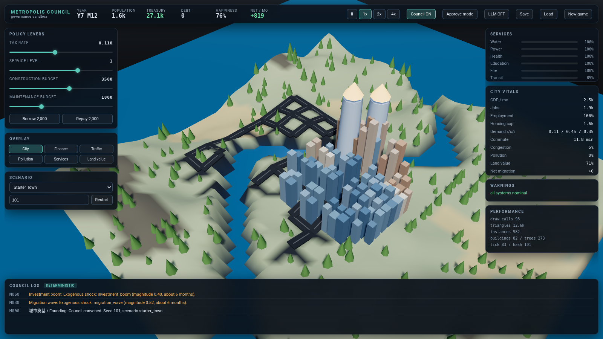

# Metropolis Council

A **deterministic 3D city-governance game** and a **reproducible LLM governance benchmark**, built as one self-contained open-source project.

You are the mayor. You set tax rates, budgets and priorities; a municipal **council** of specialist departments turns that into audited construction proposals that a deterministic arbiter either funds or rejects. The simulation is a fixed monthly tick that runs entirely in your browser, offline, with no account, no API key and no network access. Optionally the council can be played by an LLM through an OpenAI-compatible endpoint - and if that endpoint is missing, slow, or returns garbage, the game falls back to the deterministic council and keeps playing.



---

## What this actually is

Three things, deliberately kept separate so none of them can pretend to be another:

1. **A playable game.** Seeded terrain, a growing city, a full economic and fiscal loop, six scenarios, victory and bankruptcy, save/load.
2. **A benchmark.** A headless runner that puts different governance agents - rule-based baselines today, LLMs behind the same interface - into identical worlds with identical information and budgets, and scores the outcomes with published metrics, confidence intervals and hard failure floors.
3. **A study in discipline.** Every action in the game, from a button click to an LLM proposal, goes through one validated command queue. Every credit is ledgered. Every run is replayable to the same state hash.

The benchmark measures **performance inside a simulation**. It is not a measure of real-world governance ability, and this project says so everywhere it could be misread.

---

## Quick start

Requirements: Node.js >= 22 and pnpm. Everything else is pinned through the lockfile.

```bash
pnpm install
pnpm typecheck          # strict TypeScript across all packages
pnpm test               # acceptance self-check (18 checks)
pnpm build              # builds the playable web app into dist/web
pnpm start              # serves it at http://127.0.0.1:4173
```

Then open <http://127.0.0.1:4173>. The game plays entirely client-side.

Play with the URL:

```
http://127.0.0.1:4173/?scenario=declining_finance&seed=104
```

### Controls

| Input | Action |
|---|---|
| drag | orbit the camera; vertical drag also moves time of day |
| shift-drag / right-drag | pan |
| wheel | zoom |
| speed buttons | pause, 1x, 2x, 4x (1 tick = 1 month) |
| sliders | set tax rate, service level, construction and maintenance budgets |
| overlay buttons | recolor the city by finance / traffic / pollution / services / land value |

---

## The simulation

One tick is one month. The order inside a tick is fixed:

1. Validate and apply every command through the single command queue.
2. Fire and expire pre-scheduled exogenous shocks.
3. Services: demand from population, capacity from built units and their quality.
4. Economy: housing, jobs, demand, land value and pollution, all derived from land use.
5. Traffic: road load, congestion, commute time.
6. Population: migration, gated by housing, jobs, water and power.
7. Finance: the full ledger.
8. Monthly report, histories, milestones, victory or bankruptcy.

All randomness comes from **four independent RNG streams** (terrain, events, population, economy), serialized into every save. Agents calling in different orders cannot perturb exogenous events.

### Units are published, not hidden

Agents receive the same cost formula the validator enforces:

| Quantity | Rule |
|---|---|
| Housing | `160 x density` per residential tile |
| Jobs | `0.32/citizen + 55/commercial tile + 70/industrial tile`, scaled by demand |
| Utility demand | `population x perCapitaDemand` |
| Utility capacity | `units x build.capacity x (0.75 + 0.25 x quality)` |
| Tax revenue | `population x taxRate x 18 x difficulty x income factor` |
| Municipal payroll | `population x 1.3` per month |
| Import price | unmet demand is bought externally at a real cost |

A city cannot grow past what its housing, jobs and utilities can carry. Growth without infrastructure stalls; infrastructure without a tax base bankrupts you.

### Deliberate sampling, stated honestly

Individual citizens are **not** simulated one by one and no LLM is called per citizen. Population is an authoritative total; regional distribution and social state come from a bounded **representative household sample** (12-900 samples, 4 citizens per sample). The sample never feeds back into the total - an earlier design did, and it produced runaway growth that ignored infrastructure. That bug is documented in the engineering log.

---

## The council

Five departments - planning, finance, transport, welfare, industry and environment - each read the **public observation only** and emit a bounded proposal. A deterministic arbiter ranks them by expected utility minus cost and uncertainty penalties, rejects anything unaffordable or illegal, and emits one command. The full ranking and every rejection reason are logged.

Three player modes:

- **Delegate** (default): the council acts within your budget envelope.
- **Approve**: proposals above your approval threshold wait in `state.pending` until you approve or reject them.
- **Advisory**: turn the council off and set policy yourself.

### Optional LLM councillor

The LLM never touches the world state. It may only return a JSON proposal with whitelisted actions. Everything else is rejected and logged.

```bash
cp .env.example .env.local   # then fill in MC_LLM_BASE_URL / MC_LLM_API_KEY / MC_LLM_MODEL
pnpm build && pnpm start
```

The key stays in the server process. The browser only ever calls the relative proxy `/api/llm`, so a production build contains no secret. On timeout, 429, non-JSON, schema failure, illegal action or budget breach, the adapter retries a bounded number of times and then falls back to the deterministic rule proposal.

---

## The benchmark

```bash
pnpm bench            # 3 baselines x 3 scenarios x 5 seeds = 45 real episodes
```

Outputs land in `results/`: `smoke.json` (full episodes), `smoke.csv`, `smoke.md`. Every number is measured on the machine that ran it.

**Two tracks.** In the *council* track a fixed scripted mayor holds the policy envelope and the tested agent is the council. In the *mayor* track the tested agent sets policy and a fixed rule council executes. The other seat is always fixed, so cross-track results are never mixed.

**Six dimensions**, each 0-100 with linear published thresholds: prosperity 20, finance 20, services 20, environment and health 15, equity 10, resilience 15. Hard floors - bankruptcy, chronic water shortage, service collapse - are reported separately and never folded into the score.

**Honest replay semantics.** A recorded action sequence reproduces the same state hash on the same simulator version. A remote LLM is not expected to produce the same actions twice, and the benchmark does not claim it will.

### Measured baseline results (v0.1, this machine)

45 episodes x 120 months x 3 baselines, wall clock 531 s total:

| baseline | mean composite | mean final pop | mean final treasury | failures |
|---|---|---|---|---|
| no-op | 73.8 | 1,773 | 32,721 | **5 / 15** |
| finance-greedy | 75.6 | 1,610 | 145,059 | 0 / 15 |
| rule council | **79.5** | **2,140** | 40,941 | 0 / 15 |

The ordering is the intended one and it is not a strawman ranking: the rule council grows the most population and never fails; the greedy baseline survives by hoarding cash while shrinking; doing nothing kills the city in five of fifteen runs. Thresholds are **uncalibrated v0.1 constants** published in `SCORE_CONFIG`, not psychometric results.

### A real local model, for contrast

Run against a local Ollama endpoint (qwen3:8b-nothinking), same scenario and seed, 36 months, 6 decisions: it returned six valid proposals with no fallback in 255 s, and scored **71.0** - below the rule council (84.9) and below doing nothing (79.7). It spent money without moving the binding constraint. Full record, including why one episode is not a ranking: [docs/LLM_INTEGRATION.md](docs/LLM_INTEGRATION.md).

See [docs/BENCHMARK.md](docs/BENCHMARK.md) for the full protocol.

---

## Repository layout

```
packages/
  core/      deterministic simulation - no DOM, no Node, no network
  council/   rule departments, arbiter, LLM adapter, offline protocol mocks
  bench/     episode runner, baselines, scoring, replay, smoke suite
  render/    procedural three.js city renderer
  sim/       headless CLI (new/run/bench/replay/selfcheck/serve)
  server/    static host + server-side LLM proxy
apps/web/    Vite app: game loop, HUD, camera
docs/        architecture, usage, benchmark protocol, engineering log
results/     measured benchmark output and screenshots
```

`@metropolis/core` is pure TypeScript, which is why the whole simulation can run in a browser tab and in a headless CLI from the same code.

---

## Verification

`pnpm test` runs 18 acceptance checks, all passing:

fixed-seed determinism, save/load round-trip, corrupt-save rejection by checksum, four classes of illegal action, rule-council output, five distinct maps, reachable bankruptcy, scenario catalogue, six offline LLM failure modes, and a full episode whose recorded actions replay to the same final hash.

```
$ pnpm test
=== SELFCHECK 18/18 ===
```

Determinism was verified across separate processes, not just within one run.

---

## What is NOT done

Stated plainly, because a prototype that hides its gaps is worse than one that lists them:

- No multiplayer, no modding API, no audio.
- The economy is a coherent simplified model, not a calibrated economic simulation; parameters are self-consistent game units, not real-world data.
- Traffic is aggregate link loading, not per-vehicle pathfinding.
- The LLM path has been exercised against a **real local model** (qwen3:8b via Ollama) end to end: six schema-valid proposals, zero fallbacks, 255 s total. See [docs/LLM_INTEGRATION.md](docs/LLM_INTEGRATION.md). That is one episode, not a study - the 8B model scored 71.0, below both the rule council (84.9) and no-op (79.7) on that seed.
- Score thresholds are uncalibrated v0.1 values.
- The renderer is stylised low-poly procedural geometry, not a photoreal asset pipeline.

See [docs/ENGINEERING_LOG.md](docs/ENGINEERING_LOG.md) for the full, dated list.

---

## License and provenance

Code is **Apache-2.0** (see [LICENSE](LICENSE)). All 3D content is generated at runtime by this repository's own code; no external models, textures, sounds or commercial-game assets are included. Third-party dependencies and the architecture study of Egregoria (inspected, **not** incorporated) are recorded in [THIRD_PARTY.md](THIRD_PARTY.md).

Not affiliated with, endorsed by, or derived from Cities: Skylines or any other commercial title. No trademark, model, texture, sound or data file from a commercial game is used.
